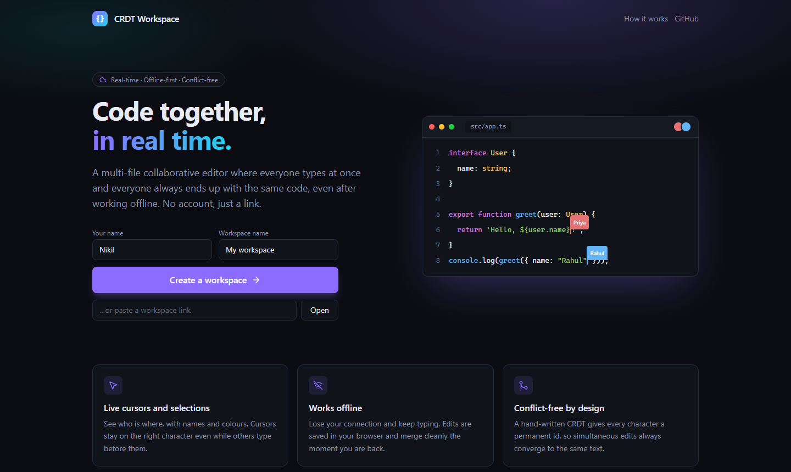
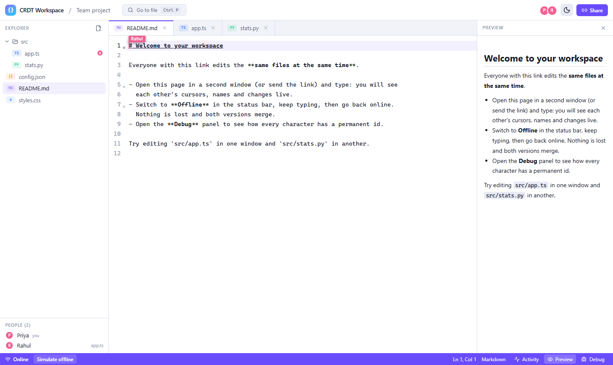
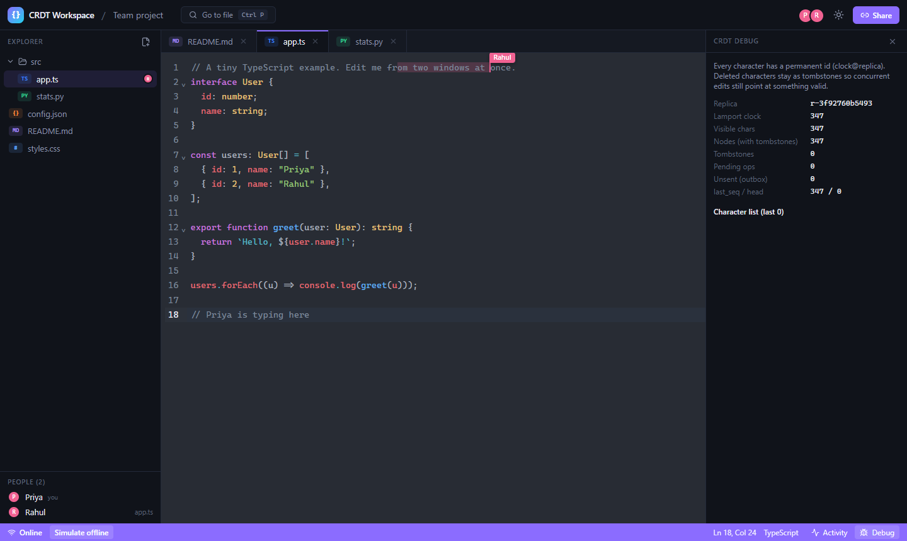

# Real-Time Collaborative Editor using CRDTs

A real-time **collaborative code workspace**: a multi-file project where many people edit at once, see each other's cursors and which file everyone has open, work offline, and always end up with identical code on every device. The merge logic is a **CRDT (RGA, Replicated Growable Array) written from scratch** in dependency-free TypeScript, then compared against Yjs.


<details>
<summary>More screenshots</summary>

| | |
|---|---|
|  |  |
|  | |

</details>

**Author:** Nikil R

> **Status (2026-11-23):** implemented and tested on a development machine. The CRDT, sync client, FastAPI server, Next.js app, load and chaos tests and the Yjs comparison are done and measured. The server tests pass on SQLite and on real PostgreSQL 18 with Redis 5. Not done or not verified: the Docker files could not be built locally (no Docker; CI builds them), there is no demo GIF and no live deployment yet. See [Limitations](#honest-limitations).

## The one-paragraph explanation

Every character gets a permanent unique ID. An edit says "insert this character after the character with ID X", not "insert at position 5". Because the meaning of an edit never depends on what else changed, edits can arrive in any order, twice, or after being held offline, and every device still ends up with the same text. The server only relays and stores edits. It never decides who wins.

Two people type at the same spot at the same time (Priya types `R`, Rahul types `S`, both after the `A` of `CAT`). Both replicas end up with `CASRT`: ties are broken by comparing the characters' ids, not by guessing intent. A test for exactly this case is in `packages/crdt/test/replica.remote.test.ts`.

## Architecture

```
  Browser A                                           Browser B
 +----------------------+                          +----------------------+
 | CodeMirror 6         |                          | CodeMirror 6         |
 | editor binding       |                          | editor binding       |
 | DocSession (sync)    |                          | DocSession (sync)    |
 |  - RGA CRDT replica  |                          |  - RGA CRDT replica  |
 |  - outbox (IndexedDB)|                          |  - outbox (IndexedDB)|
 +----------+-----------+                          +-----------+----------+
            | WebSocket (JSON)                                 | WebSocket
            v                                                  v
        +---------------------------------------------------------+
        |  FastAPI server (1..N processes)                         |
        |  validates shape, de-duplicates, stores, assigns seq,    |
        |  acks, broadcasts. Never interprets an operation.        |
        +-----------+-------------------------+-------------------+
                    v                         v
             PostgreSQL / SQLite        Redis pub/sub
        (append-only op log, snapshots)  (fan-out between processes)
```

Clients own the merge logic; the server owns delivery and storage. That is why offline editing works: an offline client is just one whose operations are delivered late. Details: [`docs/02-ARCHITECTURE.md`](docs/02-ARCHITECTURE.md), the algorithm: [`docs/03-CRDT-DESIGN.md`](docs/03-CRDT-DESIGN.md), the wire format: [`docs/04-PROTOCOL.md`](docs/04-PROTOCOL.md).

## Features

- **Multi-file workspace:** file explorer with folders, tabs, quick open (`Ctrl P`), create, rename and delete files that everyone sees instantly, syntax highlighting for TypeScript, JavaScript, Python, JSON, Markdown, HTML and CSS, line numbers, bracket matching, autocomplete, search and a dark/light theme.
- **Presence:** names, colours and remote cursors/selections (stored as character ids, so they stay on the right character while others type), plus a People list showing which file each person has open.
- **Activity feed:** a shared history of who created, renamed and edited which file (edits are merged per person and file by the Python server).
- **Markdown preview** that is sanitised, because another collaborator controls the text.
- Live multi-user editing of every file through the CRDT.
- Offline editing: typing never blocks; unsent edits are saved in IndexedDB and survive a reload; everything merges on reconnect.
- Gap-free server sequence numbers and a contiguous client watermark, so a missed broadcast is always detected and repaired.
- Client-uploaded snapshots and a compaction job for long documents.
- Redis fan-out so several server processes can serve one document.
- Debug panel that shows character ids, tombstones, clock, pending operations and the outbox.
- Prometheus metrics and a provisioned Grafana dashboard.

## Quick start (no Docker needed)

Requirements: Node 20+ with pnpm, Python 3.11+ with [uv](https://docs.astral.sh/uv/).

```powershell
pnpm install
cd server; uv sync; uv run uvicorn app.main:app --reload     # API on http://localhost:8000 (SQLite file)
pnpm dev:web                                                  # app on http://localhost:3000 (second terminal, repo root)
```

Open http://localhost:3000, click **Create a workspace**, and open the link in a second window. Open different files in each window and watch the People list and cursors; use **Simulate offline** in the status bar to try the offline flow, and **Debug** to see the CRDT characters and tombstones.

With Docker (written, not yet run on the development machine): `docker compose up --build` starts PostgreSQL, Redis, the server, the web app, Prometheus (9090) and Grafana (3001); `--profile scale` adds a second server process.

## Tests

| What | Command |
|---|---|
| CRDT unit and property tests | `pnpm test:crdt` (`pnpm test:crdt:full` for 10,000 schedules per property) |
| Sync client (against an in-memory fake server, with chaos runs) | `pnpm test:client` |
| Web unit tests (store, channel, binding, IndexedDB, Markdown sanitising) | `pnpm test:web` |
| Server (SQLite and fake Redis) | `cd server; uv run pytest` |
| Server against real PostgreSQL and Redis | set `TEST_DATABASE_URL` (e.g. `postgresql+asyncpg://user:pw@localhost:5432/collab_editor_test`) and `TEST_REDIS_URL`, then `uv run pytest` |
| End-to-end, real browsers (Edge by default, `PW_CHANNEL=chromium` elsewhere); 17 tests | `pnpm e2e` |
| Regenerate the README screenshots | `SCREENSHOTS=1 pnpm --filter @rce/web exec playwright test -g screenshots` |
| Load test (10, 50, 100 clients), chaos run | `pnpm loadtest -- --clients 50 --duration 30 --spawn-server` (`--chaos` adds faults) |

<!-- RESULTS:START -->

## Results

All numbers below were produced on 2026-11-23 on one machine (11th Gen Intel Core i3-1115G4, 7.8 GB RAM, Windows 11, Node 24) with clients and server on the same machine and the server on a **SQLite file, not PostgreSQL**. Each line links to a report in [`docs/results/`](docs/results/) that records the exact command. Treat them as demo-scale, relative numbers.

**Convergence (property-based fuzzing, 0 divergences).** 2 to 6 replicas, random edits, delivery order, delays and duplicates; after delivery every replica must show identical text, equal to the surviving characters. Details and the sanity check that the tests can fail: [`crdt-convergence`](docs/results/2026-11-23-crdt-convergence.md).

**Load test: random typing (5 characters per second per client, 30 s) into one document**

| Clients | Runs | Verdict | Ops generated | Stored ops/s | p50 ms | p95 ms | p99 ms | DB write ms (avg per batch) |
|---|---|---|---|---|---|---|---|---|
| 10 | 3 | all passed | 1,428 to 1,431 | 47.6 to 47.7 | 46 to 51 | 67 to 73 | 90 to 105 | 11.4 to 13.6 |
| 50 | 3 | all passed | 7,355 to 7,497 | 245.2 to 249.9 | 1,903 to 4,681 | 8,201 to 12,456 | 8,323 to 14,065 | 21.4 to 28.9 |
| 100 | 3 | none passed; the server had stored 78% to 89% of the operations when the 120 s settle window ended | 14,577 to 14,833 | 379.8 to 441.5 | 8,555 to 8,706 | 20,878 to 21,186 | 22,552 to 22,960 | 111.8 to 183.2 |

A run **passes** only if, after typing stops and faults end, every replica holds identical text, the server stored every operation that was generated, and a fresh client replaying the log gets the same text. A run that fails because the server is still working through a backlog is **saturation, not divergence**: the single-process server on a SQLite file, with all simulated clients on the same 4-thread laptop, could not keep up with the offered load. No claim is made that 100 clients converge.

Latency is measured from the moment a client creates an operation to the moment another client's session receives it from the server (same process clock), so it includes the client's 30 ms batching window and the database write.

**Chaos run** (20 clients, 30 s of typing with random disconnects, 1 to 10 s offline periods, delayed, duplicated and reordered messages, and one server restart mid-run):

- verdict: passed; operations generated 2913, stored by the server 2913 (missing: 0)
- distinct final texts across all replicas: 1; a fresh client replaying the log matches: True
- faults injected: 62 dropped connections, 3403 delayed and 1774 duplicated messages; server restarted: True; time to settle after faults stopped: 1.6 s
- latency during chaos is dominated by offline periods (p50 613 ms, p99 16,135 ms) and is not a performance figure

**Own CRDT versus Yjs** (same seeded synthetic trace, one run, results checked against a plain-string model; [details](docs/results/2026-11-23-yjs-comparison.md)):

| Edits in the trace | 10,000 | 50,000 |
|---|---|---|
| Local apply, own / Yjs (ms) | 200 / 225 | 7,075 / 949 |
| Replay on a fresh replica, own / Yjs incremental (ms) | 333 / 107 | 9,751 / 439 |
| Size: own operations as JSON / Yjs merged update (bytes) | 1,885,112 / 76,828 | 9,661,410 / 415,296 |

Own implementation is slower and larger than Yjs, as expected for a first version; the gap widens with document size.

**CRDT optimisation:** 30,000 random single-character inserts took 139.1 s before and 1.6 s after indexing nodes by reference (idle-machine run, one run each). Deletes and in-order remote apply did not improve. Run-to-run noise on this laptop was large, see [`crdt-optimisation`](docs/results/2026-11-23-crdt-optimisation.md).

<!-- RESULTS:END -->

## Repository layout

```
packages/crdt/      the RGA CRDT (TypeScript, no runtime dependencies) + tests + benchmarks
packages/client/    sync session: outbox, reconnect, watermark, presence (framework agnostic)
apps/web/           Next.js app (CodeMirror 6, Zustand, Tailwind, Dexie) + Playwright tests
server/             FastAPI relay, SQLAlchemy models, Alembic migration, compaction job, tests
loadtest/           load and chaos runner with fault injection
ops/                Prometheus, Grafana dashboard, Caddyfile
docs/               design, protocol, database, testing, deployment, results, learning journal
```

## Tech stack

| Layer | Choice |
|---|---|
| CRDT core | TypeScript (strict), no runtime dependencies; Vitest + fast-check |
| Web app | Next.js (App Router) + React + TypeScript, Tailwind CSS (design tokens, dark/light), shadcn-style components, Zustand, CodeMirror 6 with language packs, Dexie (IndexedDB), marked + DOMPurify |
| Server | Python, FastAPI + WebSockets, Pydantic v2, SQLAlchemy 2 (async), Alembic, structlog, uv, Ruff |
| Storage | PostgreSQL (append-only operation log + snapshots); SQLite for local development |
| Scale-out | Redis pub/sub |
| Tests | Vitest, fast-check, pytest, Playwright, custom load and chaos runner |
| Observability | Prometheus + Grafana |
| Deploy | Docker Compose, Caddy (HTTPS), GitHub Actions |

## Honest limitations

- **Performance is a first version.** One node per character in an array: editing is O(n) per operation, a 50,000-edit trace is about 7x slower to apply and 22x slower to replay than Yjs, and the JSON wire format is about 23x larger than Yjs's merged update (see the Yjs comparison in `docs/results/`). Run-length encoding, a tree index and a binary format are the known fixes and are not done.
- **Plain text only.** No rich text (the CRDT is a sequence of characters), no accounts or permissions (workspaces are shared by an unguessable link), no end-to-end encryption, no code execution.
- **Starter text counts as an edit** in the activity feed: the server cannot build CRDT operations, so one client types the starter files in and that shows up as "edited".
- **Project presence is per server process plus Redis**: if a server process crashes, its people stay in the list until their clients reconnect.
- **Tombstones are never garbage collected**; memory and state size grow with deletes.
- **Interleaving:** concurrent typing of whole words at one spot can interleave characters (a known weakness of simple sequence CRDTs).
- **Measured on SQLite on one laptop**, with clients and server on the same machine. The results below say what that means; they are not production numbers.
- **Not run locally:** Docker (images and Compose stack) because Docker is not installed on the development machine; the GitHub Actions workflow is the first place they are built.
- **The 100-client load scenario does not pass**: one Python process on a SQLite file, sharing a 4-thread laptop with 100 simulated clients, falls behind (see results).
- No demo GIF and no live deployment yet. "Demo-scale, tested with simulated clients" is the accurate description, not "production-ready".

## Documentation

[`docs/01-PRD.md`](docs/01-PRD.md) goals and targets, [`02-ARCHITECTURE`](docs/02-ARCHITECTURE.md), [`03-CRDT-DESIGN`](docs/03-CRDT-DESIGN.md), [`04-PROTOCOL`](docs/04-PROTOCOL.md), [`05-DATABASE`](docs/05-DATABASE.md), [`06-ROADMAP`](docs/06-ROADMAP.md) (status of every deliverable), [`07-TESTING`](docs/07-TESTING.md), [`08-DEPLOYMENT`](docs/08-DEPLOYMENT.md), [`09-DEMO-AND-RESUME`](docs/09-DEMO-AND-RESUME.md), [`10-GLOSSARY`](docs/10-GLOSSARY.md), [`learning-journal`](docs/learning-journal.md), and the dated measurements in [`docs/results/`](docs/results/).
